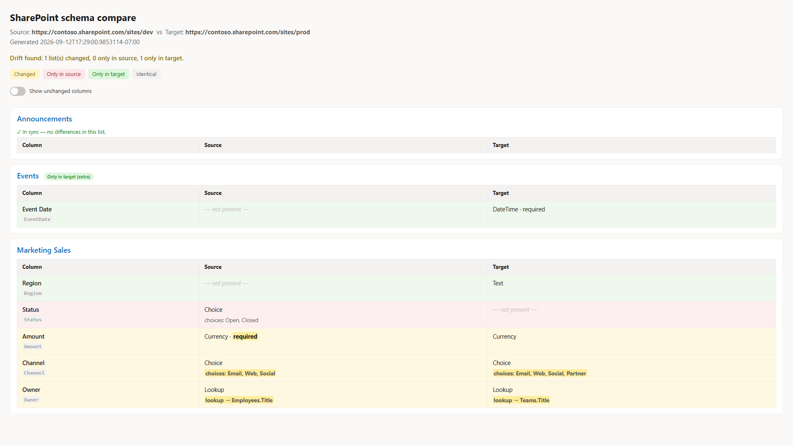

# SharePoint List Schema Compare

A **schema diff for SharePoint** — like a SQL schema compare or a `git diff`, but for SharePoint list and library structure. Point it at two sites (or a saved baseline versus a live site) and it tells you exactly **what drifted**: lists that exist on only one side, and per-field **Added / Removed / Changed**.

It does **not** copy anything. It reads structure and reports the differences.



## Why

Provisioning tools (the PnP Provisioning Engine, ShareGate, and friends) are good at *copying* structure from one site to another. None of them give you a clean, readable answer to a different question:

> *"What is actually different between these two SharePoint sites right now?"*

That question comes up constantly:

- **Environment drift** — Dev, Test, and Prod slowly diverge because someone added a column in Prod by hand.
- **Provisioning verification** — you ran `Invoke-PnPSiteTemplate`; did every field and list actually apply?
- **Migration validation** — after a tenant-to-tenant move, does the target structure match the source?
- **Schema in version control** — snapshot the schema to JSON, commit it, and diff *current versus baseline* to catch undocumented changes over time.

## What it compares

For every non-hidden custom column on every list and library:

- Column **type**, **Required**, **indexed**, **default value**
- **Choice** options (for choice columns)
- **Lookup** target list and lookup column
- **Calculated** column formula

Plus lists and libraries that exist on only one side.

### The design point that makes it work

You cannot diff raw `SchemaXml` — it is full of values that differ on every site (GUIDs, `ColName`, `SourceID`, version numbers), so a naive comparison flags everything as changed. This tool instead **normalises each column to a canonical model** and compares that. Columns are matched by **internal name**, and lookup targets are resolved from their GUID to the target **list title**, so a lookup to `Projects` matches across two sites even though the underlying list GUIDs are different.

## Requirements

- PowerShell 7+
- [PnP.PowerShell](https://pnp.github.io/powershell/) (`Install-Module PnP.PowerShell`)
- An Entra app registration for PnP sign-in (pass its client id with `-ClientId`). See the [PnP PowerShell auth docs](https://pnp.github.io/powershell/articles/authentication.html).

## Usage

### Compare two live sites

```powershell
.\Compare-SPListSchema.ps1 `
  -SourceUrl https://contoso.sharepoint.com/sites/dev `
  -TargetUrl https://contoso.sharepoint.com/sites/prod `
  -ClientId  <your-app-id> `
  -OutDir    .\out
```

### Capture a baseline, then check for drift later

```powershell
# 1. Save today's schema as a baseline you can commit to git
.\Compare-SPListSchema.ps1 -SourceUrl https://contoso.sharepoint.com/sites/prod `
                           -TargetUrl https://contoso.sharepoint.com/sites/prod `
                           -ExportSourceSnapshot .\prod-baseline.json

# 2. Weeks later, diff the live site against the saved baseline
.\Compare-SPListSchema.ps1 -SourceSnapshotPath .\prod-baseline.json `
                           -TargetUrl https://contoso.sharepoint.com/sites/prod
```

### Limit to specific lists

```powershell
.\Compare-SPListSchema.ps1 -SourceUrl ... -TargetUrl ... -Lists "Projects","Tasks"
```

### Run headless in CI (app-only certificate)

Interactive sign-in can't run in a pipeline, so for CI use an **app-only certificate**:

```powershell
# 1. Register an app with a certificate and read access (once)
Register-PnPEntraIDApp -ApplicationName "SPSchemaCompare" -Tenant contoso.onmicrosoft.com `
                       -Store CurrentUser -SharePointApplicationPermissions "Sites.Read.All"
# grant admin consent for Sites.Read.All

# 2. Compare app-only (certificate in the store, by thumbprint)
.\Compare-SPListSchema.ps1 -SourceSnapshotPath .\prod-baseline.json `
                           -TargetUrl https://contoso.sharepoint.com/sites/prod `
                           -ClientId <app-id> -Tenant contoso.onmicrosoft.com -Thumbprint <cert-thumbprint>
```

Or point at a `.pfx`: `-CertificatePath .\app.pfx -CertificatePassword (Read-Host -AsSecureString)`. When any of `-Thumbprint` / `-CertificatePath` is supplied the script connects app-only; otherwise it uses interactive sign-in. The exit code (`2` = drift) then fails the build when a site has drifted from its committed baseline.

## Output

- A colour-coded **console** summary
- **`schema-diff.html`** — a shareable, **side-by-side** report: one aligned table per list with **Source** and **Target** columns, each row a column, colour-coded (only-in-source, only-in-target, changed) with the differences sorted to the top. Identical columns are shown too, so the report doubles as **schema documentation** for both sites even when they are in sync. Pass `-NoInventory` for a differences-only view.
- **`schema-diff.json`** — machine-readable, for automation
- An **exit code** you can gate a pipeline on:
  - `0` — schemas are in sync
  - `2` — drift found
  - `1` — error

That exit code makes it usable as a **structure gate in CI** — fail the build if Prod has drifted from the approved baseline.

## Tests

Unit tests for the diff engine (Pester 5+):

```powershell
Invoke-Pester -Path .\Tests
```

The script guards its main block (`if ($MyInvocation.InvocationName -eq '.')`), so the tests dot-source it to load the functions without running a report.

## Roadmap

- v2: content types, views (columns / sort / filter), and Managed Metadata term-set resolution.

## License

MIT — see [LICENSE](LICENSE). Free and open source.
